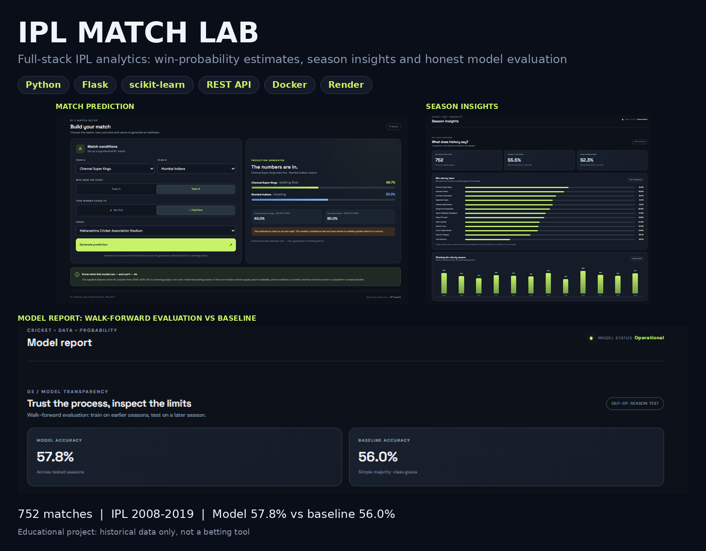
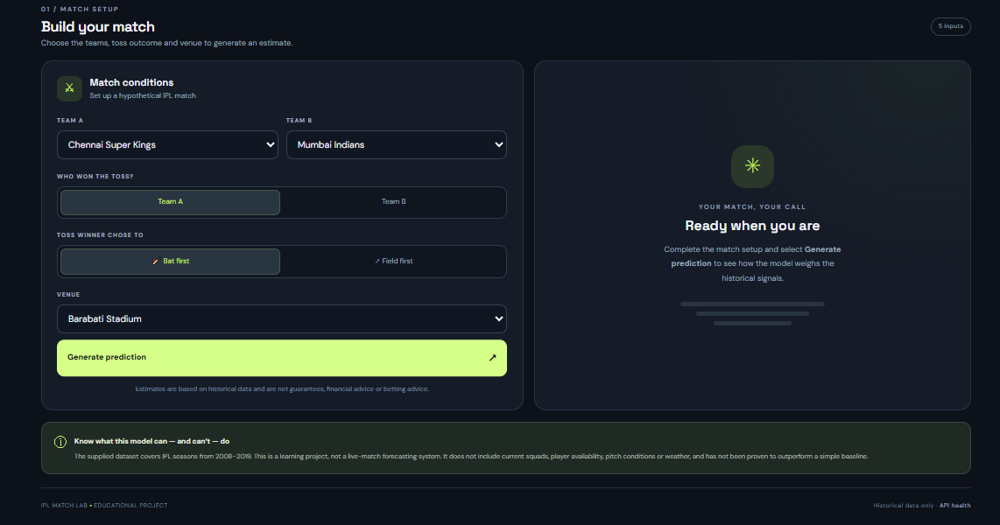
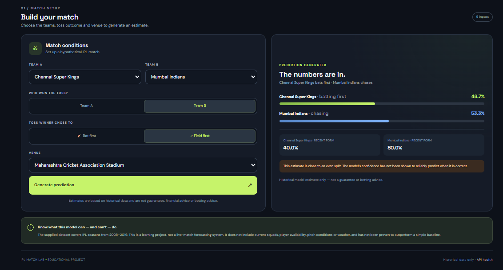
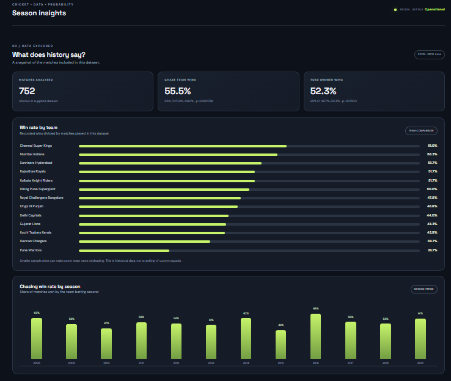
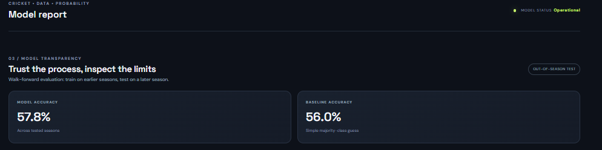

<div align="center">

# 🏏 IPL Match Lab

**A full-stack IPL analytics web app: match win-probability estimates, historical season insights and a transparent model evaluation.**

[](https://www.python.org/)
[](https://flask.palletsprojects.com/)
[](https://scikit-learn.org/)
[](Dockerfile)
[](#deploy-on-render)

<!-- Add your live demo link on the next line (remove the comment markers): -->
<!-- ### 🔗 [Try the Live Demo →](YOUR_RENDER_URL) -->

[Features](#features) •
[Demo](#demo) •
[Model results](#model-results) •
[API](#rest-api) •
[Run locally](#run-locally) •
[Limitations](#limitations)



</div>

---

## Overview

IPL Match Lab lets you set up a hypothetical IPL match (two teams, toss winner, toss decision and venue) and returns an experimental win-probability estimate based on 752 historical matches from 2008 to 2019. It also shows season-level insights and a walk-forward evaluation of the model against a simple baseline.

The frontend and the Flask REST API are served by the same application, so there is no separate frontend deployment or API URL to configure.

## Features

- **Match predictor:** pick teams, toss winner, bat/field decision and venue to get a win-probability estimate with recent-form context
- **Season insights:** overall win rate by team, chase vs toss-winner win rates and chasing win rate per season
- **Model report:** walk-forward (out-of-season) validation compared with a majority-class baseline
- **REST API** for health, metadata, predictions, insights and evaluation
- **Responsive UI** built with plain HTML, CSS and JavaScript
- **Deployment ready:** `render.yaml`, `Procfile` and `Dockerfile` included

## Demo

**Match setup**



**Prediction result**



**Season insights**



**Model report**



## Model results

The model is evaluated with a **walk-forward test**: train on earlier seasons, test on a later season (2012–2019).

| | Accuracy |
|---|---|
| Model | 57.8% |
| Baseline (always predict the majority class) | 56.0% |

The model is only about 2 percentage points above the baseline, so it has **not been shown to be a reliable predictor**. The app says this openly in the UI and probabilities near 50% are flagged as "close to an even split". I included the baseline on purpose: an accuracy number means little without something to compare it against.

Some findings from the historical data (752 matches):

- Teams batting second won about 55.5% of matches.
- The toss winner won about 52.3% of matches.

## Limitations

- The dataset covers IPL seasons **2008–2019**. It is not live or current-season data.
- It does not include current squads, player availability, pitch conditions or weather.
- Predictions are experimental estimates based on historical data. They are not guarantees and **not betting advice**.
- Some teams have small sample sizes, which can make their win rates misleading.
- Team names and venues must match the options returned by `/api/meta`.

## Tech stack

- **Backend:** Python, Flask, scikit-learn, joblib, pandas, Gunicorn
- **Frontend:** HTML5, CSS3, vanilla JavaScript
- **Deployment:** Render (Blueprint), Docker

## Project structure

```text
ipl_project/
├── app.py                 # Flask app exposed as `app` (used by Gunicorn)
├── server.py              # Local development entrypoint
├── ipl_core.py            # Data loading, features, prediction and evaluation logic
├── train_model.py         # Trains and saves the model
├── ipl_model.joblib       # Trained model
├── test_core.py           # Tests
├── requirements.txt
├── render.yaml
├── Procfile
├── Dockerfile
├── data/
│   └── matches_clean.csv
├── static/                # index.html, styles.css, app.js
└── assets/screenshots/    # README images
```

## REST API

| Method | Endpoint | Purpose |
|---|---|---|
| `GET` | `/api/health` | App and model health, number of matches loaded |
| `GET` | `/api/meta` | Available teams, venues, match count and seasons |
| `POST` | `/api/predict` | Estimates an outcome from the selected match inputs |
| `GET` | `/api/insights` | Historical team and season summaries |
| `GET` | `/api/report` | Walk-forward validation results against a baseline |

**Prediction request**

```json
{
  "team_a": "Mumbai Indians",
  "team_b": "Chennai Super Kings",
  "toss_winner": "Mumbai Indians",
  "decision": "bat",
  "venue": "Wankhede Stadium"
}
```

Use the exact team and venue names returned by `GET /api/meta`.

## Run locally

**Windows (PowerShell)**

```powershell
py -m venv .venv
.\.venv\Scripts\Activate.ps1
python -m pip install --upgrade pip
python -m pip install -r requirements.txt
python server.py
```

If PowerShell blocks activation, run `Set-ExecutionPolicy -Scope Process -ExecutionPolicy Bypass` and activate again.

**macOS / Linux**

```bash
python3 -m venv .venv
source .venv/bin/activate
python -m pip install --upgrade pip
python -m pip install -r requirements.txt
python server.py
```

Open <http://127.0.0.1:5000> in your browser.

## Deploy on Render

**Blueprint (recommended)**

1. Push the project contents to a GitHub repository (make sure `render.yaml`, `requirements.txt`, `app.py`, `server.py`, `ipl_core.py`, `ipl_model.joblib`, `data/` and `static/` are committed).
2. In the [Render Dashboard](https://dashboard.render.com/), choose **New + → Blueprint** and connect the repository.
3. Render reads `render.yaml`. Review the settings and deploy.
4. Open `<your-render-url>/api/health`. A healthy deployment returns JSON with `"status": "ok"`.

**Manual Web Service**

- Build command: `pip install -r requirements.txt`
- Start command: `gunicorn app:app --bind 0.0.0.0:$PORT --workers 2 --timeout 120`

> On Render's free tier the service sleeps when idle, so the first request can take 30–60 seconds.

## Troubleshooting

- **`ModuleNotFoundError`:** activate the virtual environment and run `python -m pip install -r requirements.txt`.
- **Render build fails:** open the service **Logs** and check the first error. Confirm the files listed above are in the repository root.
- **`/api/health` returns `status: error`:** check the `error` field and the Render logs. The model or dataset may not have loaded.

## Author

**Sohel Ali**: [GitHub](https://github.com/Sohel123-png) · [LinkedIn](https://www.linkedin.com/in/sohel-ali-6435253a8/) · sayyedsohelali448@gmail.com
